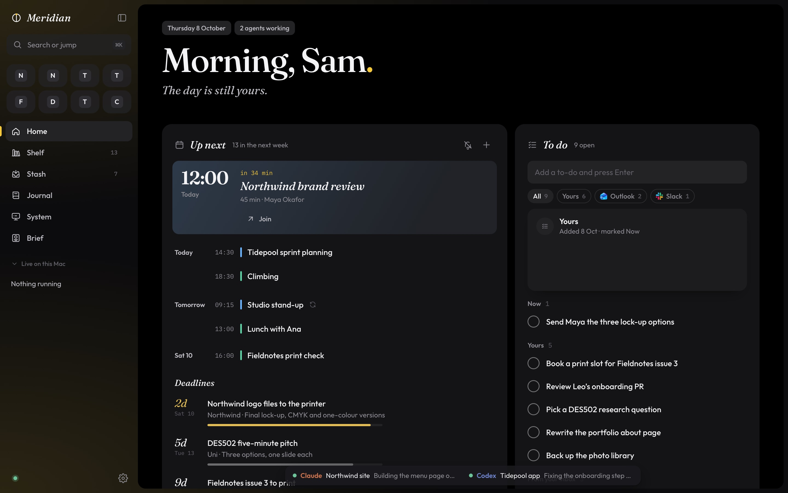
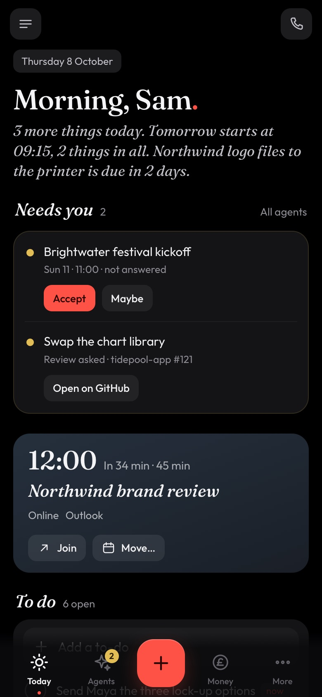

# Meridian

Meridian runs on your own computer. Your calendar, to-dos, links, notes and drafts sit on one page, next to the AI agents doing work for you. Nothing leaves your machine unless you connect it to something.



I built it for myself, as my final-year design project at Ulster University, and used it every day while I did. This is the first public version. It's early, and it's shaped around one person's day. If that sounds useful, give it a go.

## What's in it

- **Home.** What's up next, your to-dos and the links you use most, under a greeting and the planet of the day.
- **Shelf.** Every link you've saved, with previews, sorted the way you want.
- **Stash.** Drop anything in: a link, a note, a screenshot, a file. Find it again by searching.
- **Drafts.** Write an email, a message or a page together with an agent. You edit it, you approve it, and it remembers every change.
- **Agents.** Claude Code, Codex and ChatGPT can read your day and add to it through Meridian's MCP server. Each agent can get its own key with only the permissions you give it.
- **Looks.** Five looks, eight accents, and a choice of type. It also works on a phone.



## Run it

You need [Node.js](https://nodejs.org) 22 or newer. There's nothing to install and no build step.

```sh
git clone https://github.com/sheawilson0/meridian-home.git
cd meridian-home
node server.js
```

Then open <http://127.0.0.1:4980/command>.

The first time it runs, Meridian makes a `config.json` and a `data/` folder next to the code. Everything starts empty and every connector starts off, so it doesn't read anything on your computer until you tell it to.

### Try it with made-up data first

```sh
npm run demo
```

This opens a world that belongs to someone called Sam, with a full calendar, to-dos and drafts. You can change anything. It's all thrown away when you stop the server.

## Connect your things

Meridian works on its own, but it's better with your calendar and your tools. The first time you open it, a welcome card on Home walks you through your name, a first to-do, a first link and your calendar. **Connect more** opens a list of connectors, each off until you switch it on, each saying what it needs.

| Connector | What it adds | What it needs |
| --- | --- | --- |
| Calendar | Up next, meeting reminders | A calendar link (ICS) from Google, Outlook or iCloud |
| GitHub | Your repos and pull requests | The `gh` command, signed in |
| AI sessions and usage | What Claude Code and Codex are doing, and what they cost | Claude Code or Codex on this computer |
| Tailscale | Open Meridian on your phone and other computers | Tailscale, signed in |
| Link previews | Titles, icons and screenshots for saved links | Permission to fetch the pages you save |
| Notifications | Reminders on your phone | A topic on [ntfy](https://ntfy.sh) |

Most of them switch on straight away, without a restart. You can also set them in `config.json` under `connectors`. The full list, with every setting, is in [docs/open-source/fresh-profile.md](docs/open-source/fresh-profile.md).

## Connect an agent

Meridian speaks MCP at `/mcp`. Agents on the same computer can connect straight away.

**Claude Code**, through the small bridge in this repo:

```sh
claude mcp add meridian -- node /path/to/meridian-home/scripts/meridian-mcp.js
```

**Codex**, in `~/.codex/config.toml`:

```toml
[mcp_servers.meridian]
command = "node"
args = ["/path/to/meridian-home/scripts/meridian-mcp.js"]
```

To give an agent its own key with limited permissions, make a grant:

```sh
node scripts/mcp-grant.js create --name "Claude Code" --scopes read,draft-write
```

The key is shown once. Agents send it as a Bearer token (for the bridge above, set `MERIDIAN_TOKEN` to the key). There are four permissions: `read`, `draft-write`, `todo-write` and `host-control` (opening things on your screen). `node scripts/mcp-grant.js list` shows your keys and `revoke <id>` stops one straight away. [docs/open-source/security.md](docs/open-source/security.md) has the details.

## Where your data lives

- Settings: `config.json` (a backup sits beside it).
- Everything else: `data/`. It's plain JSON and files, so you can read it, copy it and back it up like any folder.
- Choose other places with `MERIDIAN_CONFIG`, `MERIDIAN_DATA` and `MERIDIAN_PORT`.

To upgrade, stop the server, `git pull`, and start it again. To uninstall, stop it and delete the folder. If you keep your data somewhere else, delete that too.

## Keep it private

Meridian listens on `127.0.0.1` only. It can see your files and start agents, so don't put it on the open internet. To use it from your phone, use a private network like Tailscale. Found a security problem? Please read [SECURITY.md](SECURITY.md) and report it privately.

## Status

Version 0.1, an early release. It's tested on macOS and Linux with Node 22 and 24. A few extras only work on a Mac (Keychain, Quick Look previews), and they switch themselves off elsewhere. Windows hasn't been tried yet.

Issues and pull requests are welcome. [CONTRIBUTING.md](CONTRIBUTING.md) explains how the code is laid out and what a good change looks like. The short version: Node built-ins only, plain JavaScript, no build step, and tests that use made-up data.

## Licence

MIT, see [LICENSE](LICENSE). The fonts, planet textures and session recorder come from other people and keep their own licences; [THIRD_PARTY_NOTICES.md](THIRD_PARTY_NOTICES.md) lists them.

Made by [Shea Wilson](https://sheawilson.uk).
