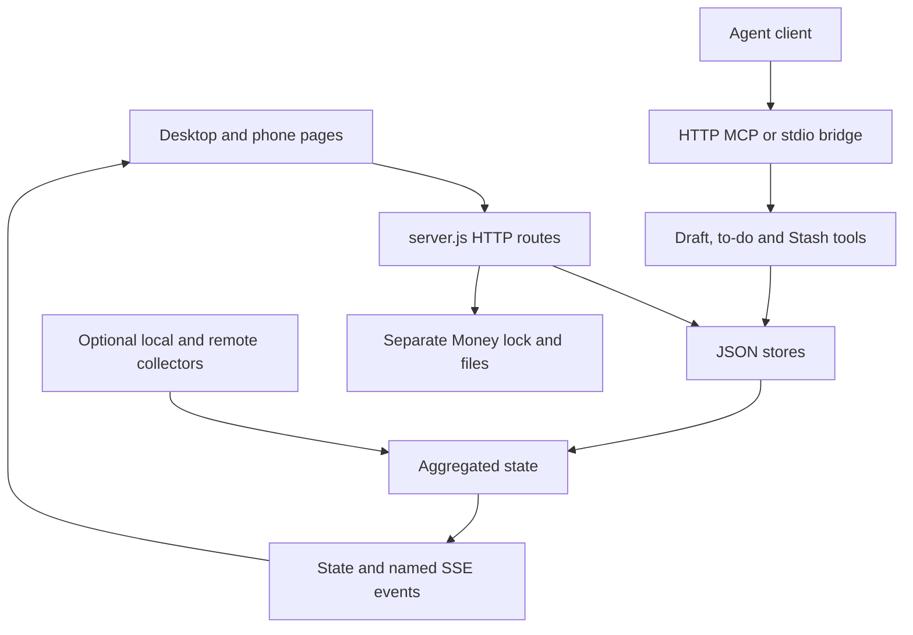

# A newcomer's map

Meridian is a CommonJS Node server and plain browser JavaScript. There is no bundler, frontend framework or runtime npm dependency. JSON files and Markdown are the database. `package.json` supplies commands without changing module mode.

This is the current architecture and a proposed release boundary, not a completed connector migration. `server.js` constructs stores, collectors and routes, assembles `/api/state`, and broadcasts state and named events over `/api/stream`. `public/command.js` renders the desktop; `public/phone.js` renders the phone. They share appearance/feel files, source icons and Money calculation helpers. Draft documents have their own event streams. Money deliberately stays out of general state and agent summaries.

## Data and request flow



“Core”, “generic integration” and “personal integration” below are release responsibilities. A file can need a split. Core should run without a login, CLI, tailnet, Obsidian vault, client project or native app. External Almanac sources must degrade independently. None of these classifications removes features from Owner's copy.

## Every root module

| Module | Boundary | What it owns / migration |
| --- | --- | --- |
| `server.js` | Core, with embedded integrations | HTTP shell, state/SSE, config, route composition. Collectors, personal prompts, fleet and filesystem discovery need extraction. |
| `agent.js` | Core | Concise JSON/Markdown overview for agents; deliberately excludes Money. |
| `todos-store.js` | Core | Own to-do CRUD and completion. |
| `links-store.js` | Core | Shelf/link persistence and ordering. |
| `projects-store.js` | Core | Project state and board movement. |
| `journal-store.js` | Core | Dated work journal CRUD; transcript/backfill sync is optional. |
| `drafts.js` | Core | Revisioned drafts, approval, history, streams and HTTP MCP tool dispatch. Personal wording/accounts need private profile settings. |
| `capture.js` | Core | Notes routed to Stash or an optional Markdown inbox. |
| `stash.js` | Core plus optional macOS enrichment | Item/file store, search, spaces, soft deletion. Swift/Vision, Quick Look and Chrome paths belong to optional adapters. |
| `stash-tools.js` | Core | Restricted Stash MCP tools; private spaces filtered separately. |
| `almanac.js` | Core feature plus generic public-data sources | Weather, moon, art/photo/colour/text discoveries and caching. Place/timezone must be configured; per-source rights and offline fallbacks need care. |
| `tell.js` | Core capture/receipt concept plus generic AI adapter | Parse/apply/undo plans and reminders. Claude planning, calendar writes and personal soul prompt are optional integrations. |
| `widget.js` | Core | Compact read view of existing state for widgets. |
| `demo.js` | Core development/demo support | Fictional world, separate API namespace. It is not isolation for all real daemon jobs or a durable editable first-run store. |
| `connect.js` | Generic integration registry UI | Discovery/status/setup hints. Replace personal agent prompts with connector metadata. |
| `calendar-ics.js` | Generic integration | ICS parsing, repeats, join URLs, attendee response identity. |
| `calendars-store.js` | Generic integration plus personal content | Config/user feeds and overrides. Real seeded classes must move into private data; generic weekly classes can remain optional. |
| `meeting-nudges.js` | Generic integration | Calendar reminder matching/deduplication. Move employer exclusion default into the private profile. |
| `brief-learning.js` | Generic integration | Rank incoming message outcomes per sender/channel. Outlook/Slack intake producers are external. |
| `github.js` | Generic integration | `gh` read collector. Uses the signed-in account; comment about a particular username is not login configuration. |
| `ai-usage-ledger.js` | Generic integration | Claude/Codex log scan, pricing, plans, CSV history and overlays. Plans/accounts are private user data; public tests need synthetic fixtures. |
| `models.js` | Generic integration | CLI model discovery, allowed delegation models/presets, saved model preferences. |
| `todo-rank.js` | Generic integration | Optional AI ranking of to-dos. Core order must work without it. |
| `stash-summary.js` | Generic integration | Optional Claude/custom-command note summaries; disable by default for public empty installs. |
| `voice.js` | Generic integration | OpenAI voice sessions, credentials and limits. Personal voice prompts need profile input. |
| `pings.js` | Generic integration | ntfy policy, quiet hours, deduplication and held messages. No pushes until opted in. |
| `local-share.js` | Generic integration | Tailscale Serve mappings and local-server ignore rules. Explicit host-level permission is needed to enable mutations. |
| `fleet-pause.js` | Generic integration, macOS only | launchd matching, pause/resume and backups. Private job catalogue should not be core discovery policy. |
| `run-changes.js` | Generic developer integration | Dogfood run snapshots, changed files and undo. Self-modification must be opt-in with restricted workspaces. |
| `feedback-attachments.js` | Generic developer integration | Feedback evidence storage and agent prompts; used by self-modifying Dogfood. |
| `brief-art.js` | Personal integration | Owner's selected daily painting catalogue, rotation and image storage. Currently an import-time fresh-clone blocker. |
| `art-images.js` | Personal artwork connector helper | Art Institute image fetch/validation. Reusable fetch helper after extraction; catalogue/licensing is optional. |
| `art-ratings.js` | Personal integration | Owner's painting choices, ratings and order. |
| `brief-icon.js` | Personal integration plus optional macOS helper | Daily artwork-derived icons and brief URL matching. Swift/native app assumptions belong to a macOS add-on. |
| `heart-health.js` | Personal integration | Client Vercel project/scope, hostname, reporting window and cached analytics. Not a general health feature. |
| `money.js` | Personal integration | Monzo Google Sheet and Trading 212, own lock, rules, balances and advice. An optional Money connector could become generic after data/provider separation. |
| `receivables.js` | Personal integration plus personal content | Claim matching; includes approved real debt/expense seeds that must never seed public installs. |
| `money-agent.js` | Personal integration | Narrow read-only finance agent API/stdio support. Keep finance credentials and capabilities separate from general MCP. |
| `money-agent-setup.js` | Personal integration | Private remote finance access setup. Do not run automatically on first launch. |

Inline server collectors not represented by independent files also need an owner: Markdown board, git roots, personal graph/Threads/LifeOS routing, preference files, local-process catalogue, journal transcript classification, intake automations, campaign Snapshot and ExampleApp feedback. Generic git/local process collectors can become optional connectors. Graph/Threads/ExampleApp/client reporting and their hardcoded classifiers belong to the private profile until there is a documented generic contract.

Wispr Flow is an external dictation/input method, named in phone hints and the timetable provenance. There is no bundled Wispr collector or API client to extract. The hints and recorded lecture-derived content should not imply it is required.

## CLI and helper scripts

| Files | Boundary | Use |
| --- | --- | --- |
| `scripts/doctor.js` | Core installation support | Read-only prerequisites, config/port checks and degradations. |
| `scripts/meridian-mcp.js` | Core agent surface | Stdio bridge to HTTP MCP; URL/token/agent from environment. |
| `scripts/journal-import.js` | Core admin support | Validate/merge journal entries; apply is an explicit mutation. |
| `scripts/ai-usage-history.js` | Generic integration | Durable AI usage history, with synthetic tests required. |
| `scripts/day-in-english.js`, `scripts/ledger-context.js`, `scripts/ledger-nightly.sh`, `scripts/journal-backfill-prompt.md` | Generic automation plus private profile | Transcript/journal automation and model invocation; owner/client wording, repo roots and scheduler are personal. |
| `scripts/money-mcp.js`, `scripts/money-setup.js`, `scripts/money-agent-private-setup.js` | Personal integration | Separate finance agent surface and explicit credential/import setup. |
| `scripts/stash-vision.swift` | Optional generic macOS adapter | Vision OCR/labels/features/thumbnail; compiled on demand. |
| `scripts/brief-icon.swift` | Personal/native add-on | Generate current artwork icons. |
| `scripts/story-build.js`, `scripts/story-build.swift` | Private coursework/dev tooling | Story exports, screenshots and narration/packaging. Not required for core install. |
| `uk.example.meridian*.plist` | Private machine configuration | Four fixed LaunchAgent templates, paths and schedules. Public installer needs generated per-user equivalents; do not install these as shipped. |

## Pages and browser modules

| Files/routes | Boundary | Public-release treatment |
| --- | --- | --- |
| `public/command.html`, `command.js`, `command.css`; `/command`, `/dashboard` | Core | Main shell and views. Owner name/weather/heuristics still need profile configuration. No layout change proposed here. |
| `public/phone.html`, `phone.js`, `phone.css`; `/phone`, `/dashboard/phone`, `/tell` | Core plus optional Tell adapter | Phone companion. Generic capture can work without AI; native dictation is optional. |
| `public/draft.html`, `drafts.html`; `/draft`, `/drafts` | Core | Draft editing/list/history; sender and university examples need neutral/private defaults. No `public/drafts.js` exists in this snapshot; `drafts.js` is the root server module. |
| `public/stash-sort.html`; `/stash-sort` | Core prototype | Swipe sorting prototype; decide whether it ships in v0.1. |
| `public/dashboard.html`; `/dashboard-classic` | Core legacy | Classic journal/project/preferences surface; still contains personal copy. Keep privately until parity/retirement decision. |
| `public/projects.html` | Core legacy | Project view; display name currently hardcoded. |
| `public/quick.html`; `/quick` | Core | Compact capture surface. |
| `public/connect.html`; `/connect` | Generic integration management | Connector/account discovery UI. |
| `public/voice/index.html`, `public/voice/call.html`, `voice-page.js`, `voice-core.js`, `voice.css` | Generic integration | Optional OpenAI voice, with explicit cost/credential setup. |
| `public/widgets/meridian-scriptable.js` | Generic platform adapter | Optional iPhone Scriptable widget. Scriptable is not part of the Node runtime. |
| `public/money-core.js` | Personal integration helper | Browser finance maths; reusable after extracting personal data assumptions. |
| `public/appearance.js`, `appearance.css`, `feel.js`, `feel.css`, `themes/nothing.css`, `themes/nothing-phone.css` | Core presentation | Shared styling/preferences/effects. Theme/brand decisions remain the owner's. |
| `public/source-marks.js` | Generic integration asset | Slack/Outlook SVG marks; provenance/trademark review required. |
| `public/brief-dia.html`; `/` | Personal integration surface | Current morning brief, personal client metrics and artwork. Proposed public root would be the dashboard or first-run gate. |
| `public/brief-paper.html`, `brief-options.html`, `brief-lab.html`, `art-library-studies.html`, `concept.html`, `dashboard-options.html` | Personal design archive | Owner-specific design experiments; keep private or make a separate reviewed research archive. |
| `public/saturday.html`, `saturday.js`, `saturday.css`, `saturday-data.json`, `weekend.html`, `year3.html`, `duel.html`, `rehearse.html` | Personal integration/content | Coursework, weekend planning, idea and presentation tools; separate uni connector/content pack. |
| `public/story/index.html`, `story.js`, `story.css`, `story-data.json`, `story.json`, `story.md` | Personal coursework/content | Public story only after explicit review and rights/privacy checks; not core install data. |
| `public/labs/home.html`, `icon.html`, `browser.html`; labs images | Personal dev archive | Experiments and real-data screenshots. Exclude from default public artifact. |

All `public/design` page groups are mapped here; screenshot/reference subdirectories follow their owning group:

| Pages | Boundary |
| --- | --- |
| `agent-view/index.html`, `agent-view/proto/{a-peek,b-panel,c-wall}.html` | Personal design research, generic agent UI concepts. |
| `art-directions/index.html`, `{almanac,daybreak,departures,overprint,phosphor,solar-flare}/index.html` | Personal design/content archive with third-party art. |
| `draft-review/index.html`, `draft-review/{demo,sample,review-core}.js`, `drafts-layouts/index.html` | Personal design research, generic draft concepts; synthetic examples still need review. |
| `focus-styles/index.html` | Personal design/dev archive. |
| `mobile/index.html`, `mobile/proto/{a,b,c,d,r}.html`, `kit.js`, `kit.css` | Personal design research with screenshots; generic phone concepts. |
| `nothing/index.html`, `nothing/rebuild.html`, `nothing-picks/index.html` | Personal design research and preference decision evidence. |
| `todo-sources/index.html`, `todo-sources/round2.html` | Personal design research, generic source attribution concepts. |
| `type/index.html`, `type/fonts/*` | Personal font research; four OFL fonts can ship with notices after branding decision. |
| `user-test/index.html` | Personal study process archive, with participant/screenshot privacy review. |
| `voice-coach/index.html` | Personal prototype/content archive; recorded/transcribed examples need separate consent/rights review. |

## Tester service

`tester/server.js` is a separate invite-gated service and private admin console, not a safe reverse proxy to all of Meridian. `tester/sandbox.js` uses the fictional demo world, persisted per tester. `invites.js`, `recordings.js`, `tasks.js`, `ai.js`, `mcp.js`, `ics.js` and `ics-worker.js` own invitation/session data, consent recording, study prompts, optional AI, per-invite agent tools and isolated published calendars. `tester/public` welcome/connect/overlay/recorder and `tester/admin` console/replay are generic research integrations. They are not required for a public personal install.

Its allowlisted static files, name scrubbing, own-cookie secret, generation checks and restricted calendar network worker are useful patterns for a hosted demo. They do not make the live dashboard or general collector process safe to expose. rrweb is an optional, separately licensed dev/research asset, and should not record ordinary installs by default.

## A zero-dependency connector shape, proposed

Use checked-in CommonJS modules and an explicit allowlist. No runtime npm package discovery, downloaded scripts or filesystem-wide auto-loading. A locally installed connector is code with the Node process's privileges; the contract alone is not a security sandbox.

```js
module.exports = {
  id: 'ics',
  configSchema: {
    feeds: { type: 'array', default: [] },
    selfEmails: { type: 'array', default: [] }
  },
  capabilities: ['network:calendar'],
  async collect(ctx) {
    return { calendar: await ctx.calendars.collect() };
  },
  routes: [],
  mcpTools: []
};
```

`ctx` should supply a validated config slice, scoped storage, clock, abort signal, fetch/CLI adapters and explicit user-enabled capabilities. The host validates a small declarative schema with built-ins. Collections run within deadlines, reuse in-flight work, retain last-good snapshots and expose status/degradation. There must be a `stop()`/disposal hook for timers, listeners and workers, or the host must own all scheduling. Avoid side effects at `require()` time.

Namespace routes under `/api/connectors/<id>/...`, and MCP names as `<id>_<tool>`. The host handles authentication, origin policy, request size limits, storage permissions and redacted error reporting before invoking any connector. Connector config responses must omit credentials/ICS URLs. Secrets come from an explicit credential provider/environment/private file, never from module exports or browser state.

Start with a static registry of disabled adapters and a separate private owner profile. Extract calendar, GitHub, AI usage and Tailscale first. Keep Monzo/T212, client metrics, ExampleApp, uni content, Wispr-specific hints and artwork curation as opt-in packs. Public tests must exercise the host with all adapters off, each adapter missing its CLI/login, and disposal after failed/slow collection.

## MCP as the agent surface

Keep a small core surface: overview, own to-dos, revisioned drafts, panel opening and selected Stash operations. HTTP JSON-RPC lives in `drafts.js`; `scripts/meridian-mcp.js` bridges stdio. Both should call the same store operations as the browser. Agents see data and make explicit receipt-producing mutations, not arbitrary filesystem or shell access.

Do not treat the agent's `?as=` name as identity. Future bearer tokens need scopes, expiry/revocation and actor attribution. Separate read overview, write to-dos, write drafts and Stash access; preserve per-revision draft approval. Money remains a separate capability/server. Connector tools are exposed only when the connector and its tool scope are enabled. Legacy `/mcp` is stateless POST JSON-RPC, not a claim of supporting every transport mode.
